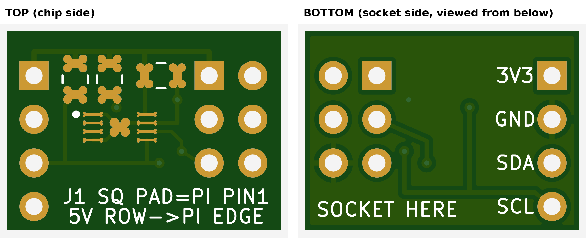

# MFi 3.0 → Raspberry Pi adapter board (MFI343S00177)

A 16 × 11.6 mm two-layer board that carries the Apple Auth 3.0 chip (MFI343S00177, XDFN-8 2×3 mm). It either plugs straight onto **Pi header pins 1–6** or gets wired to the Pi through a **4-pin header**. It works on the Pi 4 and Pi 5 with LIVI.

## Files
| File | What it's for |
|---|---|
| `MFi-Pi-Adapter-Gerbers-JLCPCB.zip` | Upload this to JLCPCB (or PCBWay, etc.) to order the bare board |
| `gerbers/` | The same Gerber and drill files, unzipped |
| `MFi-Pi-Adapter-preview.png` | What the board looks like, both sides |
| `MFi-Pi-Adapter.kicad_pcb` | KiCad file, if you want to change anything |
| `build_board.py` | Script that generated the board (KiCad 7 Python) |

### `assembly/` (parts lists)
| File | What it's for |
|---|---|
| `BOM-full.csv` | Every part, with manufacturer and LCSC numbers, for checking or hand assembly |
| `JLCPCB-BOM.csv` | JLCPCB assembly BOM: U1 + C1 (R1/R2 left out = not placed) |
| `JLCPCB-BOM-with-pullups.csv` | The same, plus R1/R2 |
| `JLCPCB-CPL.csv` | Component placement in the Gerbers' own coordinates (mm; board spans X 0…16, Y 0…−11.6, so Y is negative) |

If you order JLCPCB assembly: in the placement preview, the **chip's pin-1 dot must sit on the white silk dot**, top-left of U1. Rotate U1 in the preview if it doesn't. J1/J2 aren't in the assembly files: hand-solder them.

To regenerate it: `python3 build_board.py` (needs KiCad 7 and the `kicad-footprints` library), then open the `.kicad_pcb` in KiCad, run DRC, and plot Gerbers.



## Ordering (bare PCB, no assembly)
- Upload the zip. Settings: **2 layers, FR-4, 1.6 mm, qty 5**. Leave everything else at the defaults.
- **Surface finish:** the cheapest lead-free HASL works. **ENIG** gives flatter pads for the tiny chip if you're willing to pay a bit more.
- **Don't** add SMT assembly. You fit the parts yourself.
- Design rules used: 0.15 mm minimum clearance, 0.2 mm minimum track, 0.3 mm via drill. All are within JLCPCB's standard 2-layer limits.

## Parts
| Ref | Part | Notes |
|---|---|---|
| U1 | MFI343S00177 (XDFN-8 2×3 mm) | Your AliExpress chip |
| C1 | 100 nF ceramic, **0805** | Required: decoupling, right next to the VCC pin |
| R1, R2 | 10 kΩ, **0805** | **Optional.** The Pi already has pull-ups on pins 3/5. Only fit these if you wire J2 to a different, software I²C bus |
| J1 | 2×3 **female** header, 2.54 mm | Soldered on the **BOTTOM** (the side marked "SOCKET HERE"). Plugs onto Pi pins 1–6 |
| J2 | 1×4 male header, 2.54 mm | Optional. Use it instead of J1 to wire the board to the Pi with jumper wires |

Fit **either J1 or J2**, not both.

## Pin map (checked against the datasheet)
| Chip pad | Signal | Board | Pi header |
|---|---|---|---|
| 8 | VCC | J1.1 / J2 "3V3" | **Pin 1 (3.3 V)** |
| 5 | SDA | J1.3 / J2 "SDA" | Pin 3 (GPIO 2) |
| 6 | SCL | J1.5 / J2 "SCL" | Pin 5 (GPIO 3) |
| 1, 4, 7, centre pad | GND | J1.6 / J2 "GND" | Pin 6 |
| 2, 3 | NC | not connected | — |
| — | — | J1.2, J1.4 | Pi 5 V pins: **deliberately not connected** |

## Assembly order
1. **Chip first.** Put a thin smear of solder paste on the 8 pads, plus a small amount on the centre pad. Placing it is optional: the datasheet allows the centre pad to be left unsoldered, and the board doesn't need it for ground. Line up the **pin-1 dot on the chip with the white dot on the board**, top-left of the chip. Heat on the hot plate until the paste goes shiny and the chip settles into place on its own.
   - The pads are 0.25 mm longer than Apple's spec, extending outward, so you can see the joints and touch them up with a fine iron tip.
2. **Inspect** under magnification for solder bridges, especially between pads 5–8. Pads 2 and 3 must **not** be bridged to anything.
3. **C1**, then R1/R2 if you need them.
4. **J1 on the bottom**, or J2 on either side.
5. **Before the Pi:** with a multimeter, check 3V3 to GND on J2 (or J1 pins 1 and 6). It must **not** read as a short.

## Fitting it the right way round (important)
Plugged in backwards, it puts **5 V onto SDA and SCL** and will kill the chip.
- The **square pad of J1** goes on **Pi pin 1** (3.3 V).
- The **outer column of J1 (pins 2, 4, 6, the "5V row")** faces the **edge of the Pi**. The rest of the board sits over the Pi.
- The board also sits over Pi pins 7 and 8, but doesn't connect to them.

### With your Waveshare CAN HAT
The HAT covers pins 1–6, so either:
- Use a **stacking header** (extra-long pins) under the CAN HAT and plug J1 onto the pins sticking out the top. Check that nothing tall on the HAT is in the way.
- **Or** fit J2 and run 4 jumper wires to Pi pins 1 (3V3), 6 (GND), 3 (SDA) and 5 (SCL). You can also solder the wires to the HAT's pass-through pads. Check the HAT doesn't use GPIO 2/3.

## Software
`/boot/firmware/config.txt`:
```
dtparam=i2c_arm=on
```
LIVI `config.json`:
```json
{ "carPlayMfiI2cBus": 1, "carPlayMfiPowerGpio": -1 }
```
Test once, with LIVI stopped: `sudo i2cdetect -y 1` should show **10**. Then start LIVI and connect your iPhone. A working CarPlay connection is what proves the chip is genuine.

## Design notes
- Land pattern from Apple's Auth 3.0 CP datasheet (Table 67-2): 0.50 mm pitch, 0.30 mm pads, rows 2.90 mm apart centre to centre. Pads lengthened to 1.15 mm, outward only.
- Centre pad reduced to 1.2 × 1.1 mm to leave 0.4 mm clearance to the signal pads, which lowers the risk of bridges when hand-reflowing.
- Ground pour on the bottom layer. Ground pads 1, 4 and 7 are tied together on top as well.
- KiCad design check: 0 clearance errors, 0 unconnected pads.
